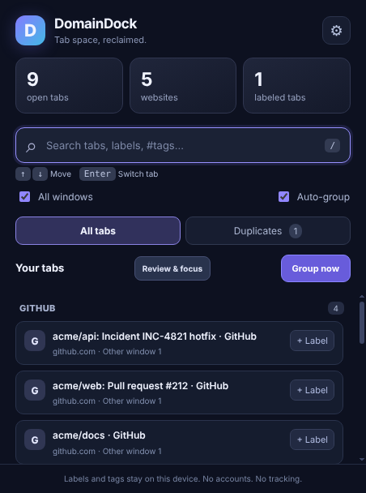
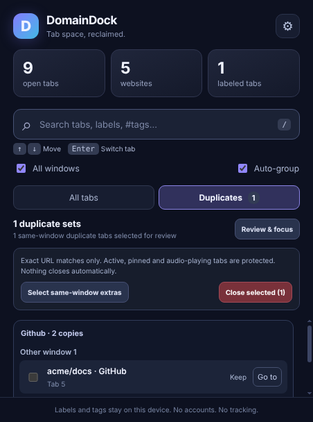
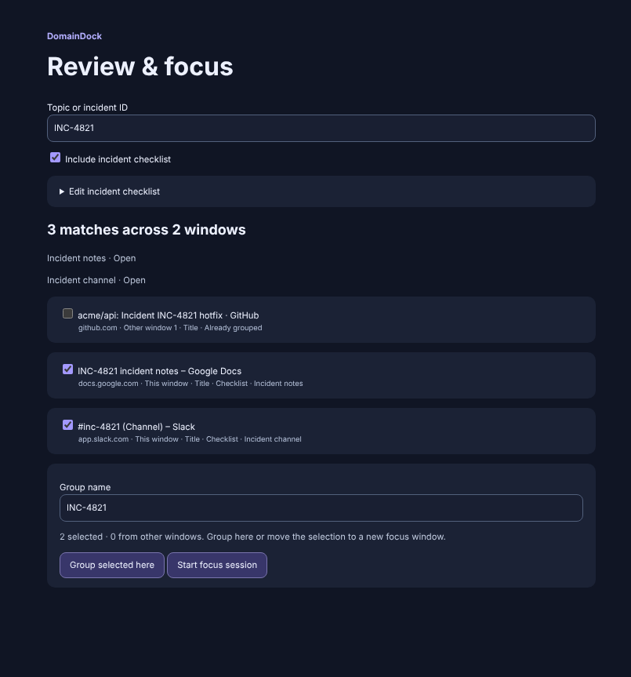

# DomainDock — Smart Tab Groups & Finder

> **Chrome extension · Manifest V3 · local-first · no dependencies**

Reduce tab clutter without losing your place. DomainDock groups tabs from the same website into **native Chrome tab groups**, then helps you find specific pages by searching **tab titles, URLs, saved labels, notes, and tags**. The **Duplicates** view lets you review repeated page URLs before choosing what to close, and **Review & focus** gathers every tab about one topic or incident into a single group or focus window, then puts them back.

| Finder | Duplicates | Review & focus |
|---|---|---|
|  |  |  |

<sub>Screenshots use demo pages served locally; no real accounts or data.</sub>

## Features

- **Auto-group open tabs:** two or more ungrouped tabs from the same website become a native Chrome group (per browser window).
- **AMZ rule out of the box:** `amazon.com`, `amazon.co.uk`, `amazon.ca`, etc. all become **AMZ**. Default group color: orange.
- **Custom group rules:** map several related domains to one personalized name and color, e.g. `github.com` → `CODE`.
- **Review duplicate tabs:** detect identical full page URLs across normal windows, see which copy is kept, and select extras to close only after confirmation. Active, pinned, audio-playing and highlighted tabs cannot be closed through DomainDock.
- **Find tabs instantly:** search across all windows, or restrict the list to the current window. Type `#shopping` to find tags. Use ↑/↓ and Enter to switch tabs from the keyboard.
- **Review & focus:** collect the tabs for a topic or incident ID from every window, review them, then group them here or move them to a focus window. One click returns them to their original windows, positions, groups and pinned state.
- **Save a useful label:** turn an ambiguous tab title into **"Headphones — compare price"**, with tags like `shopping, gift` and an optional note.
- **Persistent page labels:** labels are keyed by page URL rather than Chrome's temporary tab ID; recognized Amazon product links are normalized to `/dp/ASIN` on the marketplace root domain.
- **Privacy-first:** no server, tracking, analytics, remote scripts, content injection, or third-party libraries.
- **Respect your choices:** tabs in user-created groups aren't moved, and a tab you drag out of a DomainDock group stays out until it navigates to another site (or you click **Group now**). Pinned tabs and incognito windows are excluded.
- **Quick access:** extension toolbar icon or suggested shortcut `Ctrl+Shift+K` (`Command+Shift+K` on Mac), configurable at `chrome://extensions/shortcuts`.

## Install locally (developer mode)

1. Download this repository or extract the ZIP so that `manifest.json` is visible at the top level.
2. Open **`chrome://extensions`** in Chrome.
3. Enable **Developer mode** (top right).
4. Click **Load unpacked** and select this repository's directory (not the ZIP).
5. Pin **DomainDock** from the Extensions toolbar.
6. Open two Amazon tabs: they should form an orange **AMZ** group. Click the extension to search tabs and add page labels.

No account, build step, npm install, or API key is required.

## Find tabs with the keyboard

Open DomainDock with **Ctrl+Shift+K** (**Command+Shift+K** on macOS) and type to search. Use **↑** and **↓** to highlight a result, then press **Enter** to switch to it, including across windows. With a search term entered, **Enter** opens the first result if you haven't highlighted one. You can change the shortcut at `chrome://extensions/shortcuts`.

## Review search results and focus

Search in the finder and choose **Review & focus**. Review the matches, edit the group name and select **Group selected here** or **Start focus session**. Focus moves your selection to a dedicated window. Its DomainDock tab lets you return the session tabs or keep the window. Newly opened tabs stay where you put them. If an original window closed, DomainDock creates a replacement when returning tabs. Return tracking lasts for the current browser session.

Enable **Include incident checklist** to look for required pages. Save a hostname to match the incident ID against tab titles and URLs, or save a complete web address for a fixed page. Multiple candidates are available for manual selection.

## How to use labels and tags

1. Open an Amazon product tab.
2. Open DomainDock and click **+ Label** beside that tab.
3. Save **Label:** `Noise-canceling headphones — shortlist`.
4. Save **Tags:** `shopping, electronics, compare`.
5. Later search for `headphones`, `shortlist`, or `#compare` and click the result to jump to the correct tab.

The label appears in **DomainDock's finder**, not Chrome's native tab title. The URL-based label survives closing and reopening the same page. Amazon links with recognized ASIN-style paths survive common referral/tracking URL changes.

## Review duplicate tabs

1. Open the DomainDock popup and choose **Duplicates**. A counter shows how many extra exact-URL copies are open.
2. Review each set by window and tab position. Use **Go to** to inspect a copy. **Keep** marks the preferred surviving tab; protected tabs (active, pinned, playing audio, highlighted) cannot be selected for closure.
3. Check the boxes beside tabs you want to close, or choose **Select same-window extras** to select only safe extras **while keeping one copy in each window**.
4. Click **Close selected**. Chrome will display a confirmation dialog describing the risk of unsaved page data.
5. After confirmation, DomainDock checks the current Chrome tab URLs, windows, and protection flags again. If anything material changed, the action is blocked and you can rescan.

**Exact means exact:** URLs must match after standard URL parsing, including query string and `#fragment`. Amazon product links with different referral parameters are deliberately *not* merged by deduplication, even though the label feature may normalize them to the same annotation key. This conservative default avoids closing visually similar but functionally distinct pages. Search still finds them both. Duplicates are scanned on demand; no background or automatic tab closure occurs. Incognito and internal Chrome pages are excluded.

## Custom grouping rules

Open the extension's **Settings** button (gear icon), then add a rule:

| Name | Domains | Color |
|---|---|---|
| `AMZ` (built in) | `amazon.com`, `amazon.co.uk`, ... | Orange |
| `WORK` | `asana.com`, `miro.com` | Purple |
| `CODE` | `github.com`, `gitlab.com` | Blue |

Rules have priority over ordinary website grouping. Use **Group now** to organize existing tabs. Turn off **Auto-group** to pause future organization; it does not dissolve existing groups.

## Permissions

| Permission | Reason |
|---|---|
| `tabs` | Read tab titles/URLs to classify websites and search open tabs; focus a result; move the tabs you select in Review & focus |
| `tabGroups` | Create, inspect, and name Chrome's native tab groups |
| `storage` | Save local labels, tags, rules, incident checklist, and session-only bookkeeping (managed groups, focus-session return positions, tabs you removed from groups) |

No `host_permissions`, `<all_urls>`, or content scripts are requested. See [PRIVACY.md](PRIVACY.md).

## Limitations (v0.4)

- **Closing tabs can lose unsaved form data.** DomainDock never automatically closes tabs, but manual closure can still discard unsaved edits or session state. There is no built-in undo mechanism.
- **Page content is not indexed.** Search covers a tab's title, URL, your label, tags, and notes. To find a product not named in its tab title, add a label or note.
- Chrome groups are **window-scoped**. Automatic grouping never moves tabs between windows. Only **Review & focus** moves tabs across windows, and only the tabs you selected, after you click **Group selected here** or **Start focus session**.
- Grouping selected tabs in Review & focus unpins pinned tabs and takes tabs out of their current group. A focus session restores both when you return the tabs; **Group selected here** does not.
- Focus-session return tracking and "removed from group" records last for the current browser session only.
- Domain detection uses an **offline heuristic** for registrable domains (including common compound suffixes like `co.uk`), not the entire Public Suffix List. Add rules for exceptions.
- Existing manually grouped tabs are left alone. A manually named group with an exact matching title and matching site members can be adopted after browser restart.
- Labels are stored **per URL**, not per tab instance. Two tabs with the exact same canonical URL share the same label. Changing URLs may require relabeling.
- Data is stored in `chrome.storage.local`, not synced across machines. Labels remain until individually cleared or the extension is uninstalled.
- The extension uses the same extension-managed group where it can identify one. It does not merge or destroy manually created groups.
- Automatic grouping starts enabled and groups two or more eligible tabs on installation.
- Testing so far is automated (Node.js with mocked Chrome APIs). Run the [manual checklist](MANUAL_TESTING.md) in Chrome before publishing a release.

## Development

Run the offline, dependency-free unit tests:

```bash
npm test         # unit tests
npm run check    # syntax-check every script, then run the tests (used by CI)
```

Project structure:

```text
manifest.json         Chrome Manifest V3 configuration
background.js         Native tab grouping service worker
lib/core.js           Domain matching and search/tag logic
lib/group-engine.js   Per-window grouping and manual-group protection
lib/duplicates.js     Exact-URL duplicate detection and checked manual closure
lib/topic.js          Topic matching and incident checklist parsing
lib/focus-session.js  Reversible focus sessions (move tabs out and back)
popup.*               Finder, tag editor, auto-group toggle
focus.*               Review & focus page
options.*             Custom domain aliases and preferences
scripts/              Development checks
tests/                Node.js tests with mocked Chrome APIs
icons/                Toolbar/store-ready artwork
PRIVACY.md            Data-handling policy
MANUAL_TESTING.md     In-browser acceptance checklist
RELEASING.md          Release and Chrome Web Store checklist
```

## Roadmap

- [ ] Full Public Suffix List-based domain matching (for unusual ccTLDs)
- [ ] Import/export labels as JSON with explicit user action
- [ ] Batch tagging and grouping exclusions
- [x] Keyboard navigation through search results
- [x] Manual exact-URL duplicate review (never silently close tabs)
- [x] Review & focus: topic/incident grouping with reversible focus sessions
- [ ] Optional review-only suggestions for related links (such as Amazon product URLs with different tracking parameters)
- [ ] Integration tests using Chrome extension automation

## Releasing

See [RELEASING.md](RELEASING.md) for the release and Chrome Web Store checklist.

## Attribution and license

Independent project, built using Chrome's documented extension APIs. Licensed under [MIT](LICENSE). Not affiliated with Google, Amazon, or other websites shown in examples.
